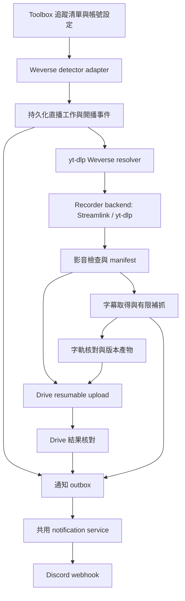

# Weverse LIVE 自動存檔與 Discord 回報整合計劃

規劃日期：2026-10-13（Asia/Taipei）。狀態：設計提案，尚未啟用監看、錄影、上傳或 Discord 發送。

## 1. 建議決策與交付範圍

在 Toolbox 新增獨立的 **Weverse LIVE 存檔** 工具，負責「開播偵測 → 開播通知與自動錄影 → 字幕處理 → Google Drive 存檔 → Discord 回報」。第一階段使用 **Toolbox 共用通知服務 + Discord incoming webhook**，每個目的頻道設定一個 webhook，多個 Toolbox 功能可共用同一目的地。不新增 Weverse 專用 Discord bot。

錄影方案優先評估 **yt-dlp 解析 Weverse + Streamlink 接收 HLS + FFmpeg 檢查／封裝**，保留 yt-dlp 錄影 backend 作比較與備援，經 P0 實測後決定預設。Streamlink 不負責開播偵測、Weverse 登入或官方即時字幕。

錄影、字幕、上傳和重試由 Toolbox 背景工作管理。Discord 是通知出口；往後需要在 Discord 查詢或操作時，再加入共用 Toolbox Discord application，沿用同一套工作服務。只有管理者、部署、權限或故障範圍確實需要隔離時，才建立 Weverse 專用 app／bot。

本次交付是可分階段實作的計劃文件與 README 入口。實作後仍須完成指定帳號、直播、字幕與 Drive 目的地的真實驗收，才能宣稱功能可用。

## 2. Toolbox 現況與整合邊界

盤點基準：Toolbox commit `1a0d8a783943a0ddc9e865da5373f742ef78a68c`。

| 現有能力 | 可重用部分 | 本功能需要新增的部分 |
| --- | --- | --- |
| FastAPI、ToolPlugin、ToolRegistry、React feature manifest | 模組註冊、lifespan、導覽、健康檢查、共用 UI | `weverse-live` plugin、API、feature 與工作台 |
| `/weverse-uploader` | 本機影片／字幕辨識、語言對應與任務詳情呈現模式 | 現有工具是「本機檔案 → YouTube」，沒有 LIVE 監看或錄影；新增獨立工具，不改原 uploader 語意 |
| Google OAuth、CredentialStore、帳號 `owner_sub` 隔離 | PKCE、refresh、後端加密與 per-app 注入模式 | 獨立 `drive_archive` purpose／credential key、`drive.file` scope 與寫入依賴；現有 `drive.readonly` 無法上傳 |
| WeverseUploadStore、UploadWorker | 檔案鎖、原子寫入、停止入列、有限停機等待與 provider 注入設計 | 專屬 LiveStore、可恢復階段、通知 outbox 與 recorder process 管理；不能直接使用既有 YouTube 重啟策略 |
| 已固定 `yt-dlp==2026.8.19` | 擷取器與既有依賴管理 | Weverse detector／resolver adapter、Streamlink 錄影 backend 與相容性 smoke test；Streamlink 尚未加入依賴，Docker 尚未安裝 `ffmpeg`／`ffprobe` |
| 持久化 `data/` volume | 部署與備份方式 | 錄影檔、字幕、manifest、加密第三方 secrets、容量管理 |
| 無現有 Discord 整合 | 平台安全、錯誤契約與設定模式 | provider 無關的 notification service、Discord webhook transport |

實作保持既有 `/weverse-uploader`、YouTube 授權、Drive 讀取 flow 與 JSON 格式相容。新 worker 明確接收 Settings、store 與 provider adapters，不能依賴背景執行緒繼承 HTTP ContextVar。新增授權能力須同步更新前端 `tools/capabilities.js` 白名單與後端授權狀態契約。[架構指南](ARCHITECTURE.md)

## 3. Weverse 與字幕的可行性結論

### 3.1 已核實與仍待驗證

| 項目 | 已知事實 | 對計劃的影響 |
| --- | --- | --- |
| LIVE 偵測 | yt-dlp 有 Weverse LIVE 與 LIVE tab 擷取器；後者有分頁及 `live_status`，原始 `ONAIR` 對應 `is_live` | 作為第三方 adapter 的起點；尚未實測當前 endpoint 的完整性、排序、限流或同時多場直播。不能當作官方公共 API 或事件 webhook |
| 即時影片 | 擷取器有 LIVE HLS 處理分支 | 先 PoC 指定帳號可播放的非 DRM 直播，確認登入、串流有效期、音訊、結束判定與重連 |
| 直播開頭 | yt-dlp 的 `--live-from-start` 支援名單未包含 Weverse | 不能保證補回偵測前片段；記錄官方開播、偵測及實際錄製起點 |
| 官方即時字幕 | Digital Membership 提供 LIVE／replay 即時自動字幕；語言依來源語言與服務支援而定 | 是否可用須以實際帳號、直播與播放器驗證，不能保證每場都有繁中 |
| yt-dlp 直播字幕 | 固定版本的 Weverse LIVE 分支明確標示直播字幕不可下載，且沒有回傳直播字幕 tracks | 單靠 `--write-subs` 無法完成「保存官方即時字幕」 |
| VOD 字幕 | 擷取器的 VOD 分支有字幕處理，但 replay 可受登入、授權、DRM 或可用性限制 | 可取得時另行補抓；不能假設所有直播之後必有可下載回放／字幕 |

來源：[yt-dlp Weverse 原始碼（固定版本）](https://github.com/yt-dlp/yt-dlp/blob/3a08beaf031ab68f966401ead017ac81fe8486cf/yt_dlp/extractor/weverse.py)、[yt-dlp README](https://github.com/yt-dlp/yt-dlp/tree/3a08beaf031ab68f966401ead017ac81fe8486cf#readme)、[Weverse 即時字幕公告](https://weverse.io/notice/24729)、[字幕語言更新公告](https://weverse.io/notice/30831)、[官方字幕說明](https://help.weverse.io/weverse/article?faq-id=000005651)。這些是文件與原始碼驗證，尚未替代真實直播測試。

### 3.2 「包括字幕」分成四種模式

| 模式 | 產物與可達成內容 | 實作階段與限制 |
| --- | --- | --- |
| 官方可取得字幕 | 保存原始 `.vtt`／`.srt`，記錄語言與來源，可另封裝 soft subtitles | 基本管線；直播中無可下載字幕時先錄影，結束後有限次補抓 VOD。VOD 字幕可能與即時字幕不同 |
| 當下播放器畫面含字幕 | 另存播放器畫面與系統音訊錄影，字幕已在畫面中；同步保留串流原檔 | 若「當下看到的官方字幕」是必要條件，此項須先驗證。播放器平台支援、會員狀態、畫面擷取、系統音訊與併發均未確認，不列為已可用能力 |
| AI 語音辨識／翻譯 | 選配生成來源語言字幕，再產生繁中翻譯；標記 `ai_generated`／`ai_translated` | 明確啟用後才執行；PoC 評估人名、重疊語音、歌曲、成本及時間。不能標示為官方字幕 |
| 字幕燒錄副本 | 保留影片原檔和字幕 sidecars，再用 FFmpeg 生成有字幕的副本 | 後續選配，耗時且增加磁碟／CPU；不以燒錄副本取代原檔 |

預設規劃為「原始影音 + 可取得的官方字幕」，繁中優先，其餘語言可選；AI 與播放器畫面錄製預設關閉。若需要即時官方字幕完整保存，必須先通過播放器錄製 PoC，再選定該模式，不能以 VOD 字幕或 AI 字幕自動替代。

字幕缺漏不阻塞原始影片上傳，但任務顯示「影片已存檔／字幕待補或缺漏」，不顯示全部完成。至少保存 `source`、`language`、`status`、`coverage`、`version`、`last_checked_at`；狀態包含 `pending`、`available`、`missing`、`unsupported`、`failed`。使用者指定的必要字幕軌齊備，才標示字幕完整。

補抓初始排程為直播結束後 5 分鐘、30 分鐘、2 小時、24 小時、72 小時、7 天；這是可調整的嘗試窗口，不是官方發布時限。期限後仍可手動補抓。VOD 時間軸和直播錄影可能不同，須先核對起點與剪輯差異；不能把整場 VOD 字幕直接套在少了開頭或中斷的錄影上。

### 3.3 Streamlink 與 yt-dlp／FFmpeg 的比較

查證版本為 Streamlink **8.6.2**（2026-10-07 發布，commit `f33007410e7a2b5717a095a23b4978f774a1493a`）。該版本官方 plugin 目錄沒有 Weverse／VLive，Weverse plugin request 仍開啟，不能假設貼入 Weverse 頁面 URL 就能開始錄影。[官方 release](https://github.com/streamlink/streamlink/releases/tag/8.6.2)、[plugin 清單](https://streamlink.github.io/plugins.html)、[Weverse plugin request](https://github.com/streamlink/streamlink/issues/5595)

| 方案 | 優點與角色 | 本案限制／決策 |
| --- | --- | --- |
| yt-dlp 解析 + Streamlink 錄影 | 重用 Weverse 擷取器取得 HLS；Streamlink 提供專用 HLS reader、片段／playlist 重試、timeout 等控制 | **主要候選**，先驗證 cookies／headers、分離音軌、signed URL 過期與長時間同步；不能先宣稱比另一 backend 更穩定 |
| yt-dlp 錄影 + FFmpeg 整理 | 已有 yt-dlp 依賴與 Weverse 擷取器，整合路徑較短 | 比較基準與備援；同樣需要 Toolbox supervisor、重連與缺段紀錄 |
| FFmpeg 直接讀 HLS | 串流與封裝能力成熟 | 不提供 Weverse 頁面解析／開播偵測；仍需 resolver，帶權限 URL 的輸入和日誌需安全處理 |

Streamlink 支援 generic HLS protocol。CLI 可用 `hls://https://...` 或 `.m3u8` 輸入；`--output/-o` 是不開播放器的檔案輸出，`--record/-r` 是播放／stdout 同時保存，檔名副檔名不代表已轉封裝。Toolbox 優先採 Python library API，在隔離 capture process 內接收短生命期 descriptor，避免將 cookie／header／signed URL 放到 CLI argv。[protocols](https://streamlink.github.io/cli/protocols.html)、[CLI 選項原始碼](https://github.com/streamlink/streamlink/blob/8.6.2/src/streamlink_cli/argparser.py)

須區分接收端重試與 Weverse 重新解析：

- `--stream-segment-attempts`、`--hls-playlist-reload-attempts` 控制片段與 playlist 重試；`--retry-streams`／`--retry-max` 控制取得可用 stream，`--retry-open` 控制開啟，不會在錄到一半掉線後重新向 Weverse 取得 URL。
- Streamlink exit、read timeout、queue deadline、無新片段或 EOF 都交給 Toolbox supervisor 判斷。來源仍 `ONAIR` 且可授權播放時，重新 resolve、開新 segment，沿用同一 job／lease；正常 `EXT-X-ENDLIST` 仍與來源狀態核對。
- `--hls-live-restart` 只能從 playlist 仍保留的最早片段開始，不能恢復已滑出 window 的開頭；記錄實際最早錄到的時間。
- 不設無限 `retry-max=0`，避免不可用來源卡住容量；`401/403` 須區分過期 URL、session、授權與地區限制，不全部當一般斷線。

來源：[Streamlink CLI transport](https://streamlink.github.io/cli.html#stream-transport-options)、[CLI 重試流程](https://github.com/streamlink/streamlink/blob/8.6.2/src/streamlink_cli/main.py)、[HLS reader 與 playlist 處理](https://github.com/streamlink/streamlink/blob/8.6.2/src/streamlink/stream/hls/hls.py)。

**Streamlink 不是字幕解法。** `--mux-subtitles` 要求 plugin 支援；8.6.2 generic HLS 處理 video／external audio，沒有已核實的 Weverse 即時字幕抓取路徑。第 3.2 節的官方字幕補抓、播放器畫面字幕與選配 AI 管線保持獨立；切換錄影 backend 不能把字幕狀態自動改為成功。[字幕選項](https://github.com/streamlink/streamlink/blob/8.6.2/src/streamlink_cli/argparser.py)、[generic HLS 原始碼](https://github.com/streamlink/streamlink/blob/8.6.2/src/streamlink/stream/hls/hls.py)

## 4. 端到端設計



### 4.1 監看與開播

- 追蹤清單以 community 為基本單位；member 篩選只在 metadata 有可靠成員 ID 時使用，不以標題文字判斷。
- 建議初始輪詢 30 秒、加 jitter；每次只讀已驗證的有限頁數／近期資料。預定直播可提高查詢頻率，但服從實際限流。這是預設設定，非平台 SLA。
- 以 `owner_sub + provider + live_id` 建唯一工作；同帳號重複事件、多來源偵測和重新啟動不能建立第二個 recorder。不同使用者先隔離錄影與憑證，MVP 不共用他人的 session 或產物。
- 首次啟用遇到正在直播時，建立部分錄影並明示起點。歷史回放不觸發開播通知；可用排程狀態只記錄預告，不提前標記錄影。
- 無公開官方 push API 的驗證證據，MVP 使用有界輪詢。API 變更、登入失效與 `429`／`5xx` 分別處理；故障時維持既有工作，降低偵測頻率並去重回報。
- 開播事件落盤後並行啟動錄影與通知；Discord 失敗不能延遲錄影。只在 recorder 已取得影音資料後發「錄影開始」，避免把已入列當作已錄到。
- 在平台正常、資料可見且資源足夠時，驗收目標為資料可見後 60 秒內偵測、偵測後 15 秒內收到首段影音；保留時間戳量測，PoC 後調整。

### 4.2 錄影、結束與恢復

- 分開 `Provider.resolve_stream(owner_sub, live_id)` 和 `RecorderBackend.start/stop/checkpoint`。Resolver 取得短生命期 HLS descriptor，Streamlink 或 yt-dlp backend 接收影音，FFmpeg 負責合併、remux 與檢查；記錄 backend、版本及切換原因，不在同一 lease 同時啟動兩個 backend。
- yt-dlp／Streamlink 的 authenticated session、cookie、header、cache 按 owner／job 隔離；Weverse extractor 有 class-level token 狀態，PoC 採隔離程序避免跨帳號共用。主應用管理 secrets，capture child 只取得必要的短期快照，不寫 CredentialStore。重新解析前讀最新 session revision，解除／更新 session 不得被舊工作覆蓋。
- Signed HLS URL 本身可能含 token。使用 Python adapter + private IPC 將 descriptor 交給 capture child，影音 bytes 再送 FFmpeg stdin；不可只因採參數陣列就認為 argv 安全。PoC 核對分離音軌／library 內部 FFmpeg 也不將 secrets 放 argv、manifest、公開 API、命令紀錄或未遮罩 stderr。無法滿足時暫不啟用該 backend。
- 初始最多同時錄影 2 場、Drive upload 1 個，監看與字幕重試使用獨立資源。超載要明示排隊與可能漏錄，不能把串流排隊當成可完整回補。
- 使用適合中斷恢復的分段容器，停止後 remux 至 MP4；checkpoint 記錄段序號、大小、時間軸、缺段與錄製模式。PoC 確認 HLS／DASH、segment discontinuity、音畫同步與版本相容性。
- 短斷線在有限窗口內重新解析有效串流 URL、續錄為新段；Streamlink 內部 retry 不取代這個 supervisor。平台暫時不可達不能視為直播結束。播放器／provider 結束證據和持續無新資料共同判定，超出窗口保留部分結果；session 無合法更新能力時明示需重新匯入，不無限重試。
- 停機停止入列，送 recorder 正常終止訊號並有限等待，最後才強制結束；已寫入片段保留。重新啟動先確認舊 process／lease 已失效，再接續尚在直播的工作；缺口寫入 manifest。
- 不將既有 UploadWorker 的「重啟全部標 interrupted，人工確認 YouTube」邏輯直接套用到新錄影工作。錄影恢復、Drive 對帳與字幕補抓各自有恢復策略。
- 記錄 `live_started_at`、`detected_at`、`captured_start_at`、`captured_end_at`、`missing_intervals`；時間未知時保留未知，不能推定完整。`ffprobe` 驗證可讀、音訊、時長與 stream；部分錄影可上傳，但獨立標記 coverage。

### 4.3 Google Drive 存檔

新增獨立 Google 授權目的 `drive_archive`，最小範圍採 `https://www.googleapis.com/auth/drive.file`，就地授權並將 refresh token 存入後端加密 CredentialStore。保留既有 `drive` 只讀授權用途；新增 `require_drive_archive_credentials`、scope checker、getter／saver、refresh latest／save／refresh-failed 分支、解除流程與相應狀態欄位。新用途禁止 legacy fallback，測試證明 refresh archive token 不修改登入 token；目前未知 credential key 可能落入既有登入處理，不可漏加分支。[Drive scope 文件](https://developers.google.com/workspace/drive/api/guides/api-specific-auth)

MVP 由 app 建立 `Weverse` 根資料夾並保存 ID。若要使用既有資料夾，透過 Google Picker 明確授權且核對寫入能力；只有貼上資料夾 URL 不代表 `drive.file` 已授予存取。背景工作不依賴瀏覽器保持開啟，但仍要處理 revoked token／需要重新授權。

建議目錄及穩定檔名（日期採 Asia/Taipei，live ID 去重；標題另存 manifest，避免標題改動造成重複）：

```text
Weverse/<community>/<YYYY-MM>/<YYYYMMDD_HHmm>_<live_id>/
  <live_id>.mp4
  <live_id>.ko.vtt
  <live_id>.zh-Hant.vtt
  <live_id>.ai.zh-Hant.srt          # 啟用 AI 時才有
  <live_id>.screen.zh-Hant.mp4      # 啟用且通過驗證的畫面錄製模式
  manifest.json
```

列示字幕只是產物格式，並不保證每場都有所有檔案。大影片走 resumable upload；session URI 加密保存，啟動後依 server 回覆查 offset，不只相信本機的已送 bytes。session 過期或最後一段逾時，先對帳再建立新 upload。[Drive resumable upload](https://developers.google.com/workspace/drive/api/guides/manage-uploads)

每個產物使用 `job_id + artifact_type + language + version` 識別，保存 Drive file ID、`appProperties`、本機雜湊／大小與最後核對結果。重試優先使用已有 file ID 或 resumable session；未知完成結果先查檔案／metadata。查詢沒有結果不等於先前 create 未成功；沒有可信 file ID 或有效 session 可核對時，保持 `upload_result_unknown`、停止自動建立第二份並交人工核對。Google Drive 允許同名檔案，不能只靠檔名避免重複。

上傳完成後核對大小與可取得的 checksum、取得 provider 回傳的連結，再更新 manifest 與回報。預設不建立 `anyone` 公開權限；使用資料夾既有權限，Discord 看得到連結的人不會因此自動取得 Drive 權限。目標頻道成員需能透過既有 Drive 分享設定開啟連結。[Drive 分享模型](https://developers.google.com/workspace/drive/api/guides/manage-sharing)

影片可先就緒，字幕後補同一資料夾；必要產物全部核對完成前不清理原檔。建議已驗證完成的本機產物保留 7 天，失敗／部分完成／字幕待補產物保留待處理，提供容量告警與人工清理，不因重試失敗刪除唯一副本。

### 4.4 工作狀態與持久化

主階段：`detected → recording → finalizing → uploading → archived`；另有 `interrupted`、`failed`、`cancelled`。字幕狀態、錄製 coverage、Drive 上傳與通知送達分開保存：影片已存檔可以同時是字幕 `pending`、coverage `partial`、通知 `delivery_unknown`。

顯示「完整完成」須滿足影音核對、錄製 coverage 可確認完整、必要字幕版本及 Drive 產物均完成；無法確認開頭或缺段時一律顯示 coverage 未確認／部分。字幕缺漏顯示 `archived_partial` 摘要，通知待補不逆轉存檔成功。

MVP 維持單體、單個監看／錄影服務實例與本機持久化 volume。只有一個可寫入 credential repository 的 application process；背景 supervisor 使用同一個 app-owned CredentialStore 與顯式 refresh transport。現有 CredentialStore 有記憶體 cache 與 thread lock，沒有跨程序 refresh 協調，不能開多個 uvicorn workers／多容器共同更新 token；隔離 capture children 不寫憑證檔。

新增版本化 `data/weverse_live.json`，由同一鎖定讀改寫交易保存工作、lease 與通知 outbox，使用既有原子 JSON 寫入模式；同一工作階段與 outbox 不能分兩次寫檔。這是新 store 的設計要求，現有 uploader store 尚未提供此能力。

Outbox 記錄 `event_id`、`destination_id`、`stage_version`、`attempts`、`next_attempt_at`、`message_id`、`delivery_status`。唯一鍵包含 owner、工作、事件階段、版本與目的地。lease 需有 owner、到期時間與 heartbeat；同機 process 鎖不能據此宣稱支援多主機／網路檔案系統。多副本需求另設交易資料庫／外部佇列與 migration，不在 MVP 擅自改動既有 JSON repositories。

### 4.5 Discord 回報與 Bot 決策

| 方案 | 能力、維護與限制 | 本案決策 |
| --- | --- | --- |
| Incoming webhook | 送出與編輯自己發的訊息；不需 bot user 或 Gateway；可調整顯示名稱／頭像 | **MVP 採用**：依目的頻道配置，Toolbox 功能共用 transport |
| 共用 Toolbox Discord application／bot | 支援 slash commands／互動按鈕、統一權限；HTTP Interactions 即可，不必常駐 Gateway | 需要 `/weverse status`、`retry`、`watch`、`pause` 等雙向操作時新增 |
| Weverse 專用 application／bot | 身分與權限可獨立，但多一組設定、token、部署與維護責任 | 僅在獨立管理者／伺服器／權限／故障範圍需求明確時採用 |

Incoming webhook 是 Toolbox 送通知到 Discord 的出口；Interactions 是 Discord 送使用者操作到 Toolbox 的入口，兩者不能混為同一機制。Application commands 可使用 `applications.commands`，不一定要安裝 bot user；監聽一般聊天／反應等事件才需要另評估 Gateway。[Webhook](https://docs.discord.com/developers/resources/webhook)、[Application commands](https://docs.discord.com/developers/interactions/application-commands)、[Gateway](https://docs.discord.com/developers/events/gateway)

升級時先加共用 Toolbox application，驗證 HTTP 簽章、guild／channel／user／role 與 Toolbox 帳號對應；不可只憑 Discord 使用者有某角色就操作任意 Toolbox 帳號。Interactions 3 秒內 ACK／defer，token 15 分鐘有效，幾小時錄影完成仍走長期 webhook 或 bot REST。[Interactions 回應規則](https://docs.discord.com/developers/interactions/receiving-and-responding)

通知使用一則可更新的狀態卡，加必要的開播／完成提醒。初始 POST 設 `wait=true`，保存 message ID 後用 PATCH 更新；不要逐段或逐個 chunk 洗頻。完成、字幕補齊與需要人工處理可另發去重事件。顯示：community／成員（有可靠資料才顯示）、直播標題、直播網址、Toolbox 任務網址、錄製時間與缺段、字幕語言及來源、Drive 已驗證連結、錯誤與下一步。

回報例（示意，不代表真實事件）：

- 開播：`[團體] 已開播｜直播連結｜Toolbox 任務連結`。
- 錄影開始：`已取得首段影音｜錄製起點 20:31（台北）｜官方字幕目前不可下載，待補抓`。
- 影片存檔：`影片已上傳 Drive｜錄製涵蓋：部分｜繁中字幕：待補｜Drive 資料夾連結`。
- 字幕完成：`繁中字幕已補齊｜來源：官方 VOD／AI 翻譯｜已核對對應時間軸`。
- 失敗：`Drive token 需重新授權｜本機錄影已保留｜Toolbox 修復入口`。

Discord `429` 按 `Retry-After`／`retry_after`，網路／`5xx` 使用有限指數退避與 jitter；`401/403` 停止並標記設定失效，webhook `404` 停用。通知故障不停止錄影／字幕／上傳。[Discord rate limits](https://docs.discord.com/developers/topics/rate-limits)

Webhook 初次 POST 逾時可能已送達，沒有通用服務端冪等鍵，不能保證 exactly-once。已知 message ID 才可恢復編輯；未知 ID 標記 `delivery_unknown`，預設等人工核對，或由明確設定選擇接受最多一次額外重送。日誌顯示 event ID 以利核對，不能無限盲重試。預設 `allowed_mentions.parse=[]`，只有設定的角色 ID 可被提醒。

## 5. Toolbox 工作台與預計檔案

新入口 `/weverse-live`，工具 ID `weverse-live`。建議頁面有「追蹤清單／直播與任務／連線與存檔設定」三個區塊，整合現有 catalog、Navbar、Dashboard、共用表格、Toast 與 ConfirmDialog。

使用者可加入 community、開關監看與自動錄影、選字幕語言／模式、設定品質與保留天數、授權 Drive 存檔、配置 Discord 目的地、查看階段進度／字幕缺漏／錄製缺口，以及單獨重試上傳、字幕或通知。三種重試不重新錄影，不重傳已核對成功的產物。設定頁登入即可進入，啟用與各項操作才檢查必要服務權限。

| 預計位置 | 職責 |
| --- | --- |
| `backend/app/tools/builtin/weverse_live.py` | ToolPlugin metadata、生命週期與健康檢查 |
| `backend/app/api/weverse_live.py` | typed watches／settings／jobs／retry API，回傳安全公開結果 |
| `backend/app/services/weverse_live_detector.py` | Provider adapter、有界輪詢、狀態標準化與重複事件 |
| `backend/app/services/weverse_live_resolver.py` | owner 隔離的 yt-dlp 解析、短期 StreamDescriptor、session revision 與 signed URL 更新 |
| `backend/app/services/weverse_live_worker.py` | per-app supervisor、lease、階段恢復與停止 |
| `backend/app/services/weverse_recorder.py` | subprocess 管理、影音段、重連、ffprobe 與 manifest |
| `backend/app/services/recorder_backends/streamlink.py`、`yt_dlp.py` | 共用 RecorderBackend 契約、各自的接收策略與安全輸入 |
| `backend/app/services/weverse_live_subtitles.py` | 官方字幕補抓、時間軸驗證及選配字幕 adapter；不塞入目前的 YouTube 字幕上傳 service |
| `backend/app/services/drive_archive_service.py` | resumable upload、artifact 對帳、已驗證結果 |
| `backend/app/services/notification_service.py`、`discord_webhook.py` | 通用通知事件、outbox dispatch、Discord transport |
| `backend/app/core/weverse_live_store.py` | owner 隔離、唯一工作、階段與 outbox 原子交易 |
| `backend/app/core/integration_secret_store.py` | Weverse session、Discord webhook 等非 Google secrets 的加密、讀取與解除；沿用加密 primitives，不硬塞進 Google token schema |
| `frontend/src/features/weverseLive/` | manifest、API types、狀態 reducer、工作台與設定卡 |
| 既有 auth／CredentialStore／capabilities／app factory／builtin registry／PATHS | 新 `drive_archive` flow 與完整 refresh 分支、就地授權、API 守門與依賴注入；前端 OAuth hash parser、`App.jsx` callback、`utils/authReturnPath.js` 白名單同步加入新用途，向下相容 |
| `backend/requirements.txt`、`Dockerfile`、部署／Google API 文件 | 固定 Streamlink 版本、ffmpeg／ffprobe、volume／容量設定、scope 與 credential 單寫入程序限制 |

擬定 API（實作前固定契約）：`GET/POST /api/v1/weverse-live/watches`、`PATCH/DELETE .../watches/{id}`、`GET/PATCH .../settings`、`GET .../jobs`、`GET .../jobs/{id}`、`POST .../jobs/{id}/retry-upload`、`retry-subtitles`、`retry-notification`、`stop`。非同步操作回 `202 + job_id`；所有工作以登入 `owner_sub` 檢查，錯誤沿用 `http_error` 契約。設定與 secrets 端點分開，讀回僅提供連線狀態與遮罩，不回傳 secret 值。

## 6. 部署、資源與維護

- 需要 24 小時可運行、可持續寫入磁碟的 Toolbox 主機／NAS／VM；一般排程任務或短時 serverless 不適合幾小時影音錄製。瀏覽器關閉不影響工作。
- 將 Streamlink 8.6.2 作 PoC 固定版本，驗證 Python 3.11、依賴與 Toolbox 映像相容性，再決定正式 pin。Docker runtime 仍需安裝 ffmpeg／ffprobe，驗證 executable 與編碼能力；錄影放 `data/weverse_live/<owner-key>/<live-id>/`，不放 ephemeral `/tmp`。路徑使用受控 ID，清理限定在此範圍。
- 先維持單個監看／錄影 supervisor；影片擷取、上傳與字幕重試分開限流，不讓轉碼堵住開播偵測。
- 粗估原檔容量：`bitrate(Mbps) × 小時 × 0.45 GB`。6 Mbps、2 小時約 5.4 GB；片段、remux 與選配副本需另留 2–3 倍暫存空間。20 Mbps 實際上傳速度下，5.4 GB 理論約 36 分鐘，還需計入網路和重試 overhead。以上是容量計算，非品質或效能保證。
- 開始錄影前檢查剩餘容量與保留策略，錄製期間持續量測；空間不足正常結束並保存可用片段、回報人工處理。Drive 配額不足只停止上傳並保留本機檔，不能循環重新錄影。
- Weverse session、webhook URL、Google refresh token、upload session URI 加密保存，provider 例外與 subprocess stderr 遮罩後才記錄。MVP 以明確的 session 匯入／更新流程為起點，不新增密碼保存；PoC 確認 session 足以支援目標直播。
- 只錄製目前帳號有權播放且技術上允許保存的來源；遇 DRM、會員／地區／授權限制時標示 blocked，不設計繞過保護。Discord 和 Drive 沒有預設自動公開分享。
- 健康檢查呈現 monitor heartbeat、依賴、磁碟、最近成功偵測、錄影與 outbox backlog；個別使用者未授權／單場失敗顯示在工具狀態，不直接使全站不可用。
- yt-dlp 與 Streamlink 固定版本；升級前重跑 Weverse contract fixtures、兩種 recorder 的相容性測試與專用帳號 smoke test，記錄版本及 provider 差異。真實測試需能連線 Weverse/CDN、Google OAuth/Drive 和 Discord；目前開發環境僅能證明文件／原始碼可行性。

## 7. 實作順序、估時與驗收

估時以一位熟悉此 repo 的開發者、帳號／主機／測試直播已備妥為假設，是開發工作日，不含等待直播、會員開通或外部權限設定。PoC 結果可能調整後續範圍；先完成可行性再承諾正式啟用。

| 階段 | 交付與依賴 | 估時 | 驗收條件 |
| --- | --- | --- | --- |
| P0：Provider／recorder PoC | 指定 community／帳號／字幕要求／主機，驗證 live listing、Streamlink 與 yt-dlp 錄影、官方字幕及 session | 2–3 日 | 同來源比較首段時間、缺段、短斷線、signed URL 過期、仍 ONAIR 的 EOF、正常 ENDLIST、長場同步、兩場併發、停機保存、CPU／記憶體；選定預設 backend。說清即時／VOD 字幕及缺開頭範圍；必要時另驗證播放器畫面與系統音訊 |
| P1：監看與錄影 | 新 ToolPlugin／LiveStore／worker／基本工作台；依 P0 結果建立 recorder | 3–5 日 | 事件去重、同時兩場、關閉瀏覽器持續工作、短斷線、重啟與磁碟不足，均不丟唯一錄影／重複起 process |
| P2：Drive 與字幕 | 獨立 `drive_archive` 授權、產物 manifest、resumable upload、官方字幕補抓 | 3–4 日 | 只讀 token 無法當寫入權限；對帳後重試不重建已成功檔；字幕缺／延遲與時間軸不符有明確狀態；未公開更改分享 |
| P3：Discord 與完整 UI | 共用 notification service／webhook、進度、修復入口與設定 | 2–3 日 | 開播、實際錄影開始、影片存檔、字幕補齊與故障均可回報；429／失效 webhook／送達不明不影響存檔 |
| P4：部署驗收 | 容器依賴、容量與恢復演練，專用 provider 帳號真實端到端驗收 | 1–2 日 + 觀察期 | 至少 3 次目標直播或等價經授權場景，含一次中斷；Drive 下載核對影音／字幕、Discord 訊息／權限核對，保留缺漏與回退紀錄 |

基本整合約 11–17 工作日。播放器畫面錄製、AI 字幕／翻譯、燒錄副本與 Discord 雙向指令各自另估，另列後續階段。官方字幕可取得性若不符合需求，先選定可接受的字幕模式，再排相應實作，不能以「只有影片」通過「含字幕完整存檔」驗收。

### 自動化檢查

- 假 provider／fixture 測試：同一 live ID 重複偵測、歷史／預告不誤觸、多直播、session 失效、兩個 owner 同場且其中一人更新／解除 session、斷線／結束、Streamlink/yt-dlp backend 切換、啟動恢復、停止錄影與磁碟不足。
- Store 測試：階段與 outbox 原子性、損毀 fail closed、並行 lease、owner 隔離、job/artifact 唯一鍵、兩個 `create_app()` 相互隔離。
- Drive／Discord adapter 測試：resumable offset、session 過期、create 成功但回應逾時且查詢暫時無結果、完成結果不明停止重建、局部字幕補傳、429／5xx／401／403／404、未知 message ID 的處理與 secret 遮罩。
- HTTP／前端測試：授權矩陣、catalog、Navbar、AppRoutes、工作詳情刷新恢復、字幕來源和 partial 狀態、人工重試及行動版版面。
- 代碼批次依 `.agents/AGENTS.md` 執行後端 Ruff／pytest、前端 format／lint／styles／typecheck／Vitest／build；UI 變更跑 E2E，版面變更依 repo 視覺基準流程驗證。預設測試不用真實 provider。

### 實作前需具備的設定

這些設定是 P0／部署輸入，不阻塞本計劃文件交付：追蹤的 community／可辨識 member、具有目標播放與字幕權限的 Weverse 帳號、字幕是否要求當下官方畫面或允許事後字幕、目標語言、24 小時主機與容量、Drive 授權帳號／根資料夾、Discord 目的頻道與 webhook、提醒角色及自動錄影啟用選項。現有 [#7／#8](REFACTOR_PLAN.md) 的真實 provider 與隔離部署驗收仍維持原本暫緩狀態，本計劃不宣稱已完成它們。
